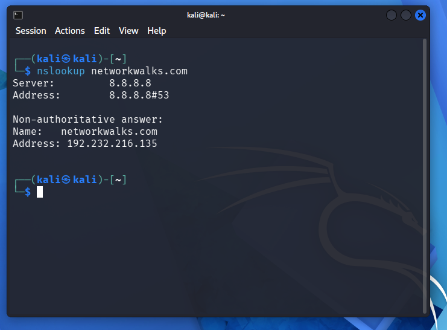
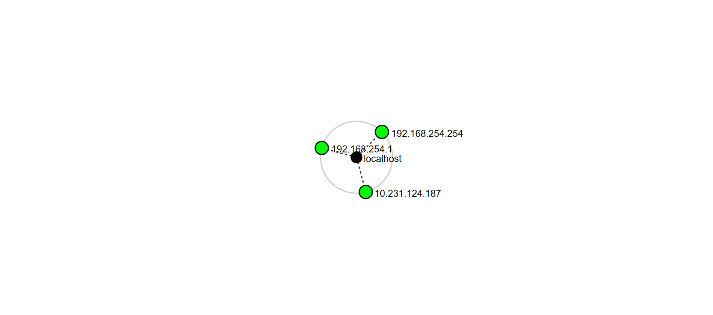

# 🔐 NetworkWalks Cybersecurity Internship — Week 2

  

  

  

  

   

  

  

  

  

<!DOCTYPE html>
<html lang="en">
<head>
<meta charset="UTF-8">
<meta name="viewport" content="width=device-width, initial-scale=1.0">
</head>
<body>

<!-- TITLE -->
<h1>Penetration Testing Report</h1>

<table>
  <thead>
    <tr><th>Pentester Name</th> <th>Sayid Ahmed Mohamed Ali</th></tr>
  </thead>
  <tbody>
    <tr><td><b>Program</b><td>Networkwalks B084</td></td></tr>
    <tr><td><b>Date</b></td><td>11/9/2026</td></tr>
    <tr><td><b>Modules Completed</b></td><td><ul><li>W2-PM1(Multiple Kali Tools)</li><li>W2-PM5(Zenmap Scannig)</li></ul></td></tr>
    <tr><td><b>Client/Target</b></td><td><ul><li>Networkwalks(secured written permission already)</li><li>My own local LAN Network</li></ul></td></tr>
    <tr><td><b>Permission secured from client ?</b></td><td>yes</td></tr>
    <tr><td><b>Phases covered</b></td><td><ul><li><b>Phase 1:</b> Reconnaissance & Footprinting</li><li><b>Phase 2:</b> Scanning & Network Discovery</li></ul></td></tr>
  </tbody>
</table>

---

<!-- 1. DISCLAIMER -->
<h2>1. Ethical Use & Liability Disclaimer</h2>

  All activities documented in this report were conducted strictly for educational and cybersecurity training purposes. Testing was limited to systems and devices that I personally own or for which I had obtained appropriate authorization.
The tools, commands, techniques, and findings presented in this report are intended to demonstrate practical cybersecurity knowledge and responsible penetration testing practices. They must not be used to access, scan, or test any system or network without proper authorization.
Unauthorized access and security testing may violate applicable laws and result in legal consequences, financial penalties, or other disciplinary actions.
I accept full responsibility for my activities and strongly support ethical hacking, responsible disclosure, and compliance with applicable cybersecurity laws and regulations.

---

<!-- 2. INTRODUCTION -->
<h2>2. Introduction</h2>

As part of my ongoing Cybersecurity Internship at Networkwalks, Week 2 focused on developing practical skills in two important stages of penetration testing: Network Footprinting and Network Scanning.
During this week's activities, I explored the information-gathering phase by performing domain footprinting on networkwalks.com using various Kali Linux tools (W2-PM1). I also conducted network scanning on my own local network using Zenmap (W2-PM5) to identify active hosts and understand the network's structure.
These practical exercises helped me understand how security professionals gather publicly available information, identify potential targets, discover active devices, and analyze network exposure during an authorized security assessment.

---

<!-- 3. TOOLS USED -->
<h2>3. Tools Used</h2>

<table>
  <thead>
    <tr><th>Tool</th><th>Purpose</th></tr>
  </thead>
  <tbody>
    <tr><td>Kali Linux &amp; Windows</td><td>Operating systems used for reconnaissance activities</td></tr>
    <tr><td>WHOIS</td><td>Find domain registration details (owner, dates, name servers).</td></tr>
    <tr><td>whatweb</td><td>Fingerprint web technologies (server, CMS, plugins, IP).</td></tr>
    <tr><td>nslookup</td><td>Resolve the domain name to its IP address using DNS.</td></tr>
    <tr><td>curl -I</td><td>Read the HTTP response headers of the website.</td></tr>
    <tr><td>wafw00f</td><td>Detect whether a Web Application Firewall protects the site.</td></tr>
    <tr><td>dnsrecon</td><td>Enumerate all DNS records (NS, MX, SPF, TXT, SRV).</td></tr>
    <tr><td>Zenmap (Nmap GUI)</td><td>Scan the local subnet to find live hosts, IPs and MAC addresses.</td></tr>
    <tr><td>Windows CMD</td><td>Local IP and MAC address identification</td></tr>
  </tbody>
</table>

---

<h2>4. Module W2-PM1-Reconnaissance Six Using Kali tools</h2>

During Week 2 of my Cybersecurity Internship at Networkwalks, I performed domain reconnaissance on networkwalks.com using six Kali Linux tools:<strong>WHOIS, WhatWeb, Nslookup, cURL, WAFW00F, and DNSRecon</strong>. Each tool was used to gather a different type of information about the target domain and its web infrastructure.

I began with <strong>WHOIS</strong> to collect publicly available domain registration details, including registrar information, registration dates, and name servers. This helped me understand the domain's registration history and identify its associated DNS infrastructure.

Next, I used <strong>WhatWeb</strong>  to identify the technologies powering the website. The results revealed the use of <strong>WordPress <code>7.1.4</code> and WP Download Manager <code>3.3.76,</code></strong> along with other web technologies. This provided an overview of the website's technology stack.

Using <strong>Nslookup,</strong> I resolved the domain name to its associated IP address, which was identified as <strong> <code>192.232.216.135.</code></strong> This demonstrated how DNS translates domain names into IP addresses, allowing systems to locate web servers.

I then used <strong> cURL </strong> with the -I option to inspect the website's HTTP response headers and identify additional information about its web application, including the exposed WordPress REST API endpoint <code> /wp-json/.</code> This helped me understand how the web server communicates with clients and exposes application-related information.
  

To investigate the website's security infrastructure, I used <strong>WAFW00F</strong> to identify the presence of a Web Application Firewall (WAF). The results indicated that <strong> ModSecurity (SpiderLabs)</strong> was protecting the website. This provided insight into the security technology used to help filter and monitor potentially malicious web traffic.
  

Finally, I used <strong> DNSRecon</strong> to perform DNS enumeration and gather additional information about the domain's DNS infrastructure, including name servers, mail servers, SPF/TXT records, service records, and other DNS-related details. This helped me understand how DNS records support domain services and infrastructure.

---

## 5. Evidence Output
 

 ---

 

 ---

  

  ---

---

---

  

   ---

## 6. Module W2-PM5- Network Discovering Using Zenmap

For the second activity, I used Zenmap to perform network discovery on my local network. The practical required me to identify my local IP address and subnet, discover active hosts, identify their IP and MAC addresses, and generate a network topology.
I first used the Windows ipconfig command to identify my local network configuration. I then entered the target subnet into Zenmap and selected the Ping Scan profile to identify active hosts.

The scan was performed using the following target network:
*	**Target Subnet:** <code>192.168.254.0/24</code>
*	**Scan Profile:** Ping Scan
*	**Total IP Addresses Scanned:** 256
  
 The scan successfully identified two active hosts:
*	<code>192.168.254.254</code>
*	<code>192.168.254.1</code>
  
The scan results also identified the following MAC address:
*	**192.168.254.254:** <code>00:50:56:F6:67:91</code> (VMware)
*	**192.168.254.1:** MAC address not displayed in the scan output.
  
Both hosts were confirmed to be reachable. The scan completed successfully in approximately **8.65 seconds.**

After completing the scan, I opened the Topology section in Zenmap to visualize the discovered network devices and their connections. I enabled the topology legend and saved the network topology in PDF format as required by the practical task.

> **Note:** The scan results documented above represent the actual results obtained from my local network during the practical exercise.
---

## 7. Topology Output and Evidence

 

 ---
 
 

---

## 8. Risk Analysis & Findings

| # | Risk / Finding | Evidence / Observation | Potential Impact | Severity |
|---|---|---|---|---|
| 1 | **Web Technology Information Exposed** | WhatWeb identified WordPress  & WP Download Manager  | Allows attackers to research version-specific CVEs. | **Medium** |
| 2 | **Target Server IP Resolvable** | Nslookup resolved the domain to `192.232.216.135`. | Reveals the direct network location of the hosting service. | **Low** |
| 3 | **Technical HTTP Headers Visible** | Curl revealed response headers and the `/wp-json/` endpoint. | Assists attackers in mapping potential API attack surfaces. | **Low** |
| 4 | **WAF Fingerprint Identified** | Wafw00f identified ModSecurity. | Informs attackers of security mechanisms protecting the application. | **Low** |
| 5 | **Public DNS Infrastructure Enumerated** | DNSRecon/Dig mapped NS, MX, and TXT records. | Facilitates broader organizational and infrastructure profiling. | **Medium** |
| 6 | **Active Host Discovered on Subnet** | Zenmap mapped a live host   | Identifies active endpoints for further internal network mapping. | **Low** |

---

## 9. Recommendations
Based on the findings from the reconnaissance and network scanning activities, I recommend the following security improvements to help strengthen the target website's security and improve local network visibility:

*	**Regular Software Updates:** Keep WordPress, WP Download Manager, and other website components updated to their latest stable and supported versions to reduce the risk of known security vulnerabilities.
*	**Web Technology** Information Protection: Review the website's configuration to minimize unnecessary disclosure of software versions and technical information that could assist attackers during reconnaissance.
*	**HTTP** Security Configuration: Review HTTP response headers and implement appropriate security headers to improve web application protection and reduce unnecessary information exposure.
*	**Web Application** Firewall (WAF): Maintain and regularly review the ModSecurity configuration to ensure that security rules are updated and effective in detecting and filtering potentially malicious web requests.
*	**DNS Security Review:** Regularly review DNS records, including MX, TXT, SPF, and other service-related records, to ensure they are accurate, properly configured, and do not expose unnecessary information.
*	**Network Monitoring and Device Management:** Regularly scan the local network to identify active devices and maintain an updated inventory of authorized hosts. Investigate any unfamiliar or unauthorized devices.
*	**Further Security Assessment:** Conduct additional authorized security testing, including vulnerability assessment and configuration reviews, to validate potential security weaknesses that were not examined during these practical activities.

---

## 10. Conclusion
During Week 2 of my Cybersecurity Internship at Networkwalks, I successfully completed two practical activities focusing on network reconnaissance, footprinting, and network scanning. These activities provided an opportunity to apply theoretical cybersecurity knowledge using practical tools and techniques commonly used in penetration testing.
In the first activity (W2-PM1), I used six Kali Linux tools: **WHOIS, WhatWeb, Nslookup, cURL, WAFW00F, and DNSRecon** to gather publicly available information about the target domain, identify its web technologies, examine DNS records, inspect HTTP response headers, and identify the Web Application Firewall. This exercise improved my understanding of how information gathering helps security professionals understand a target's digital infrastructure and potential security exposure.
In the second activity (W2-PM5), I used Zenmap to perform a Ping Scan on my local network. The scan covered 256 IP addresses within the subnet <code>192.168.254.0/24</code> and successfully identified two active hosts: <code>192.168.254.254 and 192.168.254.1</code>. I also examined the available MAC address information and generated a network topology to visualize the discovered devices.
Overall, these practical exercises strengthened my understanding of reconnaissance, DNS enumeration, web technology identification, host discovery, and network topology visualization. They also improved my confidence in using Kali Linux and Zenmap for authorized cybersecurity assessments.

---

## Author

**Sayid Ahmed Mohamed Ali**  
Cybersecurity Intern – Networkwalks
**Internship:** Networkwalks  
**Program/Batch:** B084-Networkwalks  
**Domain:** Cybersecurity  
**Week:** 02  
**Modules:** W2-PM1 and W2-PM5

---

 
